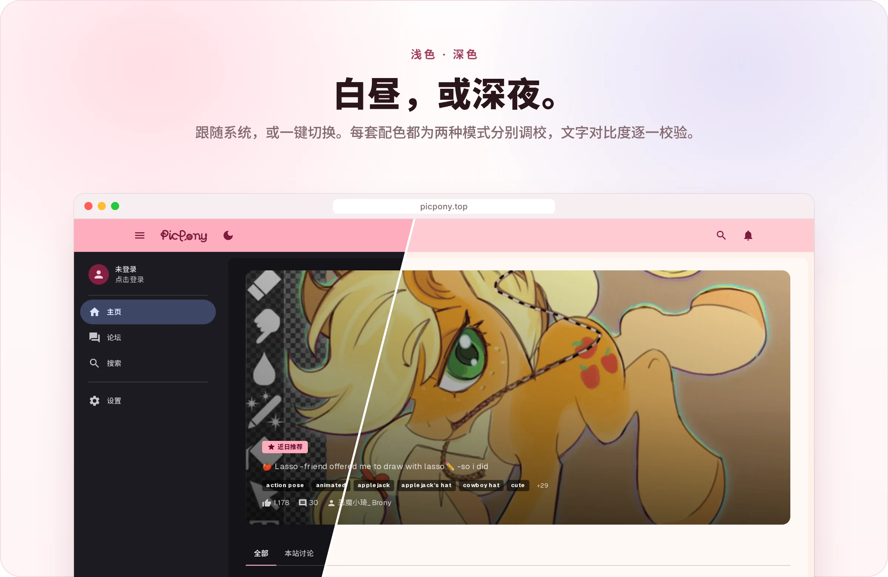

<p align="center">
  <picture>
    <source media="(prefers-color-scheme: dark)" srcset="./assets/readme/hero-dark.svg">
    
  </picture>
</p>

<p align="center">
  <a href="https://picpony.top"><b>在线访问 ↗</b></a>&nbsp;&nbsp;·&nbsp;&nbsp;<a href="#快速开始"><b>快速开始</b></a>&nbsp;&nbsp;·&nbsp;&nbsp;<a href="./AGENTS.md"><b>设计规范</b></a>
</p>

<p align="center">
  
</p>

<p align="center">
  <b>PicPony</b> 是一个小马图片浏览与社区站点的前端。<br>
  图库、论坛与个人空间共用一套 Material 3 设计系统，桌面与手机同样顺手，也能装到主屏幕。
</p>

<br>

<p align="center">
  
</p>

<p align="center">
  
</p>

<p align="center">
  
</p>

<p align="center">
  <picture>
    <source media="(prefers-color-scheme: dark)" srcset="./assets/readme/features-dark.svg">
    
  </picture>
</p>

## 快速开始

> [!NOTE]
> 需要 [Bun](https://bun.sh) 与 Node.js 22.18 或更高版本。

```bash
bun install
bun run dev
```

然后打开 [localhost:3100](http://localhost:3100)。

<details>
<summary><b>常用命令</b></summary>
<br>

| 命令 | 作用 |
| :-- | :-- |
| `bun run dev` | 本地开发，端口 3100 |
| `bun run build` | 生产构建 |
| `bun run start` | 启动生产服务 |
| `bun run check` | 格式、Lint、类型与全部测试 |
| `bun run colors:write` | 重新生成主题配色 |
| `bun run package:standalone` | 打包独立部署产物 |

</details>

<details>
<summary><b>写代码之前</b></summary>
<br>

设计令牌在 `app/globals.css`，组件原语在 `components/`。新增界面时请先用现成的原语，规则见 [`AGENTS.md`](./AGENTS.md)；架构与动效分别见 [`docs/architecture-guide.md`](./docs/architecture-guide.md) 和 [`docs/motion.md`](./docs/motion.md)。

</details>

<br>

<p align="center">
  <picture>
    <source media="(prefers-color-scheme: dark)" srcset="./assets/readme/footer-dark.svg">
    
  </picture>
</p>

<p align="center"><sub>README 中的作品均来自 Derpibooru，版权归各自作者所有。</sub></p>
