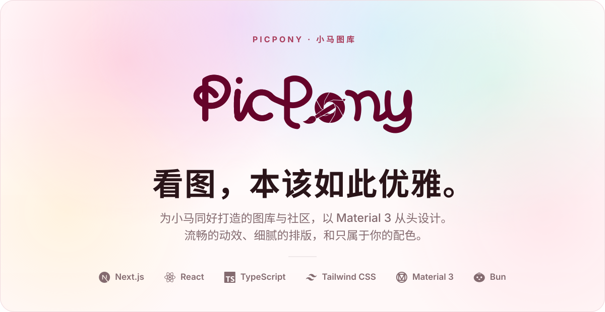
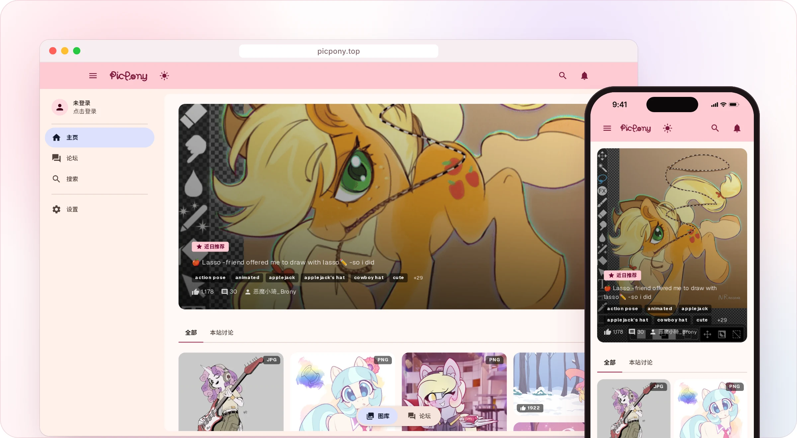
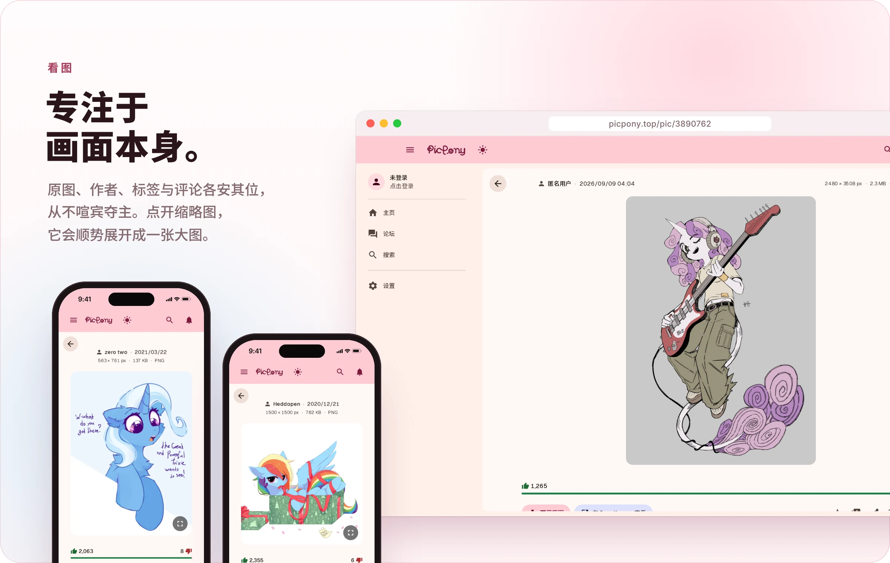
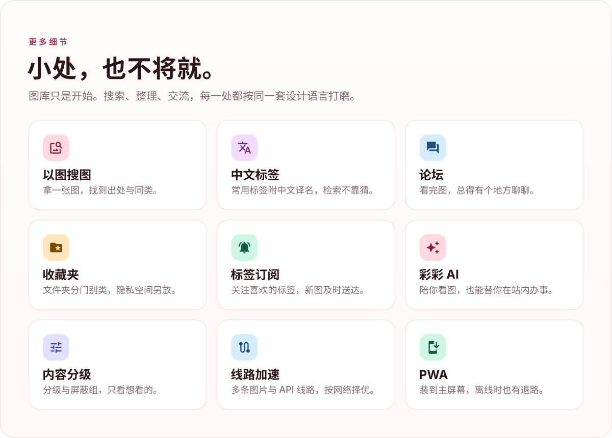
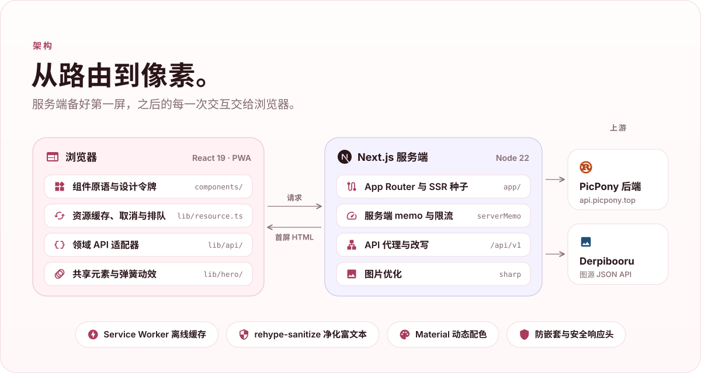

# PicPony 小马图库

<p align="center">
  
</p>

<p align="center">
  <a href="https://dev.picpony.top"><b>在线访问 ↗</b></a>&nbsp;&nbsp;·&nbsp;&nbsp;<a href="#快速开始"><b>快速开始</b></a>&nbsp;&nbsp;·&nbsp;&nbsp;<a href="./docs/README.md"><b>项目文档</b></a>
</p>

PicPony 是小马图片浏览与社区站点的前端。图库、论坛与个人空间共用 Material 3 设计系统，支持桌面、手机与 PWA 安装。

<details>
<summary>产品一览</summary>

<p align="center">
  
  
  
  
</p>

</details>

## 快速开始

需要 [Bun](https://bun.sh) 和 Node.js 22.18 或更高版本。

```bash
bun install
bun run dev
```

打开 [localhost:3100](http://localhost:3100)。开始修改前阅读 [AGENTS.md](AGENTS.md)。

| 命令 | 作用 |
| --- | --- |
| `bun run dev` | 本地开发，端口 3100 |
| `bun run build` | 生产构建 |
| `bun run start` | 启动生产服务 |
| `bun run check` | 格式、Lint、类型、测试与生成产物校验 |
| `bun run colors:write` | 重新生成主题配色 |
| `bun run package:standalone` | 打包独立部署产物 |

## 技术架构

<p align="center">
  
</p>

| 层 | 选型 |
| --- | --- |
| 框架 | Next.js 16，App Router、standalone 输出、Babel React Compiler |
| 界面 | React 19、TypeScript 5.9、Tailwind CSS 4 |
| 设计系统 | Material 3，配色由 `@material/material-color-utilities` 生成 |
| 动效 | GSAP、共享弹簧系统、Lottie |
| 富文本 | remark / rehype、`rehype-sanitize`、wangEditor |
| 图片 | `sharp` 服务端优化、Service Worker 缓存 |

目录职责与修改入口见[架构导读](docs/architecture-guide.md)。

## 配置

以下变量均可省略；默认后端是生产服务。

| 变量 | 默认值 | 作用 |
| --- | --- | --- |
| `PICPONY_UPSTREAM_ORIGIN` | `https://api.picpony.top` | 后端地址，仅接受裸 HTTP(S) 源 |
| `PICPONY_DERPI_ORIGIN` | `https://trixiebooru.org/api/v1/json` | Derpibooru 图源 API |
| `NEXT_PUBLIC_BUILD_ID` | 构建时间戳 | Service Worker 构建标识，CI 可传提交哈希 |
| `PICPONY_SERVER_MEMO_TTL_MS` | 未设置 | 覆盖服务端缓存时长；测试可设为 `0` |

## 验证

提交前运行 `bun run check`。浏览器回归使用 `bun run test:browser`；Windows 需要 Edge 与 Python Playwright。

图片详情和弹层改动还需 `bun run test:hero` 与 `bun run test:overlays`。其他专项检查见 [AGENTS.md](AGENTS.md#stack-and-commands) 和[性能文档](docs/performance.md)。

## 部署

```bash
bun run build
bun run package:standalone
```

产物位于 `dist/picpony-front-<平台>-<架构>/`。进入产物目录后启动：

```bash
node server.js
```

产物包含 `.next/static`、`public` 和 `sharp` 平台库，只能在构建时的平台运行。Linux 生产包需在 Linux 上构建。

当前为单进程模型。多副本部署前须接入共享缓存和限流，见[部署约束](docs/architecture-guide.md#deployment)。

## 文档

[文档索引](docs/README.md) · [全局约束](AGENTS.md) · [文档写作规范](docs/writing-guide.md)

<p align="center">
  
</p>

README 展示作品来自 Derpibooru，版权归各自作者所有。
