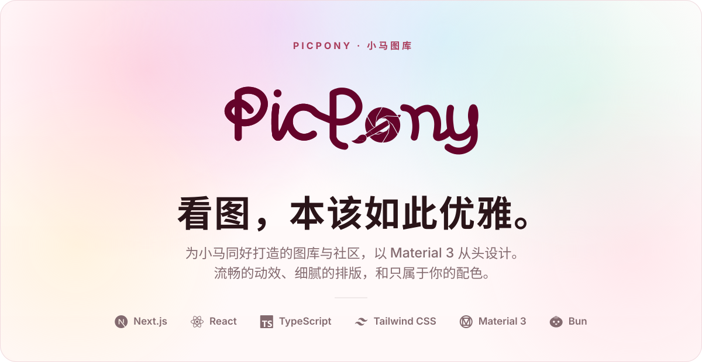
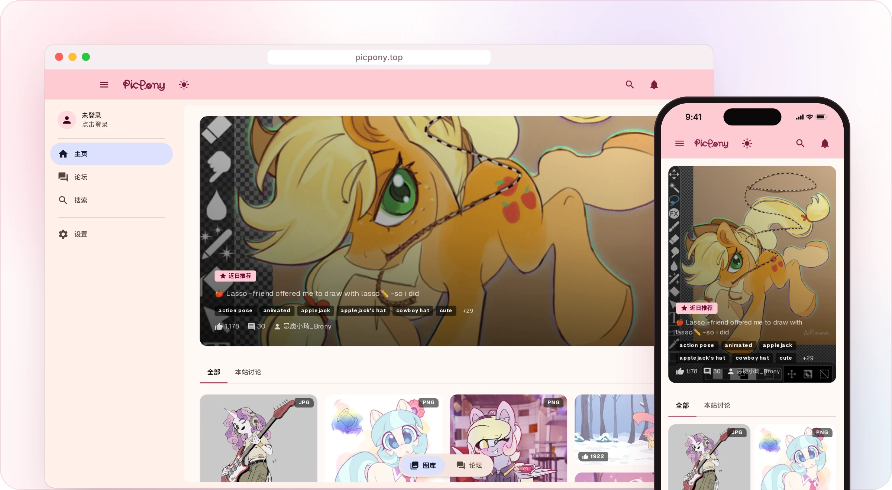
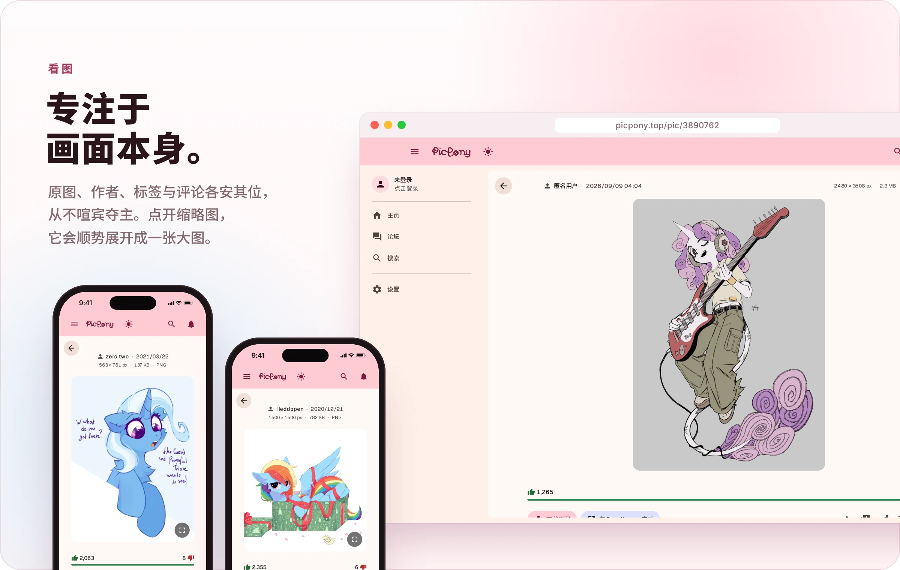
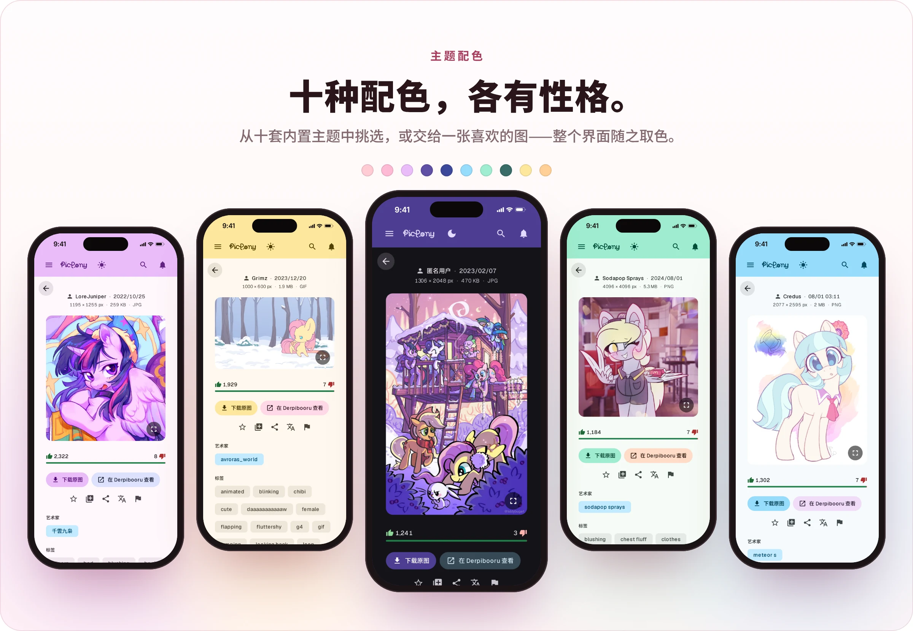
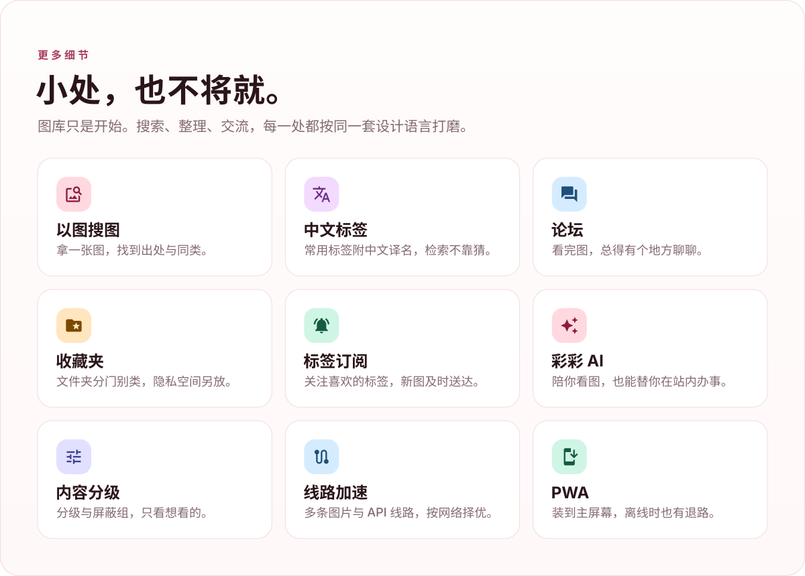
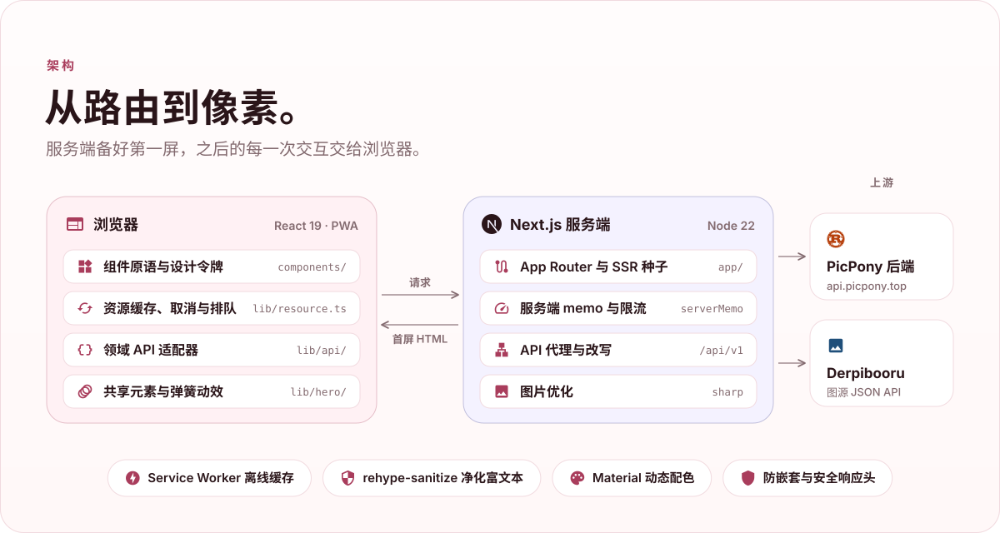

<p align="center">
  
</p>

<p align="center">
  <a href="https://picpony.top"><b>在线访问 ↗</b></a>&nbsp;&nbsp;·&nbsp;&nbsp;<a href="#快速开始"><b>快速开始</b></a>&nbsp;&nbsp;·&nbsp;&nbsp;<a href="./AGENTS.md"><b>设计规范</b></a>
</p>

<details>
<summary><b>产品一览</b></summary>
<br>

<p align="center">
  
</p>

<p align="center">
  <b>PicPony</b> 是一个小马图片浏览与社区站点的前端。<br>
  图库、论坛与个人空间共用一套 Material 3 设计系统，桌面与手机同样顺手，也能装到主屏幕。
</p>

<br>

<p align="center">
  
</p>

<p align="center">
  
</p>

<p align="center">
  
</p>

</details>


## 快速开始

> [!NOTE]
> 需要 [Bun](https://bun.sh) 与 Node.js 22.18 或更高版本。

```bash
bun install
bun run dev
```

然后打开 [localhost:3100](http://localhost:3100)。

<details>
<summary><b>常用命令</b></summary>
<br>

| 命令 | 作用 |
| :-- | :-- |
| `bun run dev` | 本地开发，端口 3100 |
| `bun run build` | 生产构建 |
| `bun run start` | 启动生产服务 |
| `bun run check` | 格式、Lint、类型与全部测试 |
| `bun run colors:write` | 重新生成主题配色 |
| `bun run package:standalone` | 打包独立部署产物 |

</details>

## 技术架构

<p align="center">
  
</p>

### 技术栈

| 层 | 选型 |
| :-- | :-- |
| 框架 | Next.js 16（App Router、`standalone` 输出、React Compiler） |
| 界面 | React 19 · TypeScript 5.9 · Tailwind CSS 4 |
| 设计系统 | Material 3，配色由 `@material/material-color-utilities` 生成 |
| 动效 | GSAP 与自研弹簧曲线，Lottie 播放插画动画 |
| 富文本 | remark / rehype 解析，`rehype-sanitize` 净化，wangEditor 编辑 |
| 图片 | `sharp` 服务端优化，Service Worker 缓存 |

### 配置

所有变量都可省略，默认直连生产服务。

| 变量 | 默认值 | 作用 |
| :-- | :-- | :-- |
| `PICPONY_UPSTREAM_ORIGIN` | `https://api.picpony.top` | PicPony 后端地址，只接受裸 `http(s)` 源 |
| `PICPONY_DERPI_ORIGIN` | `https://trixiebooru.org/api/v1/json` | Derpibooru 图源 API |
| `NEXT_PUBLIC_BUILD_ID` | 构建时间戳 | 构建标识，决定 Service Worker 缓存版本；CI 可传入提交哈希 |
| `PICPONY_SERVER_MEMO_TTL_MS` | 不设置 | 覆盖服务端缓存时长，测试时设为 `0` 让每次读取都走上游 |

### 质量保障

```bash
bun run check        # 格式、Lint、类型检查、56 个测试套件，以及配色与动效令牌校验
bun run test:browser # 真实浏览器回归
bun run perf:weight  # 生产脚本体积
```

修改图片详情或弹层时，再跑 `test:hero` 与 `test:overlays`。在 Windows 上跑浏览器回归需要已安装 Edge 与 Python Playwright。

### 部署

```bash
bun run build
bun run package:standalone   # 产出 dist/picpony-front-<平台>-<架构>/
node server.js               # 在产物目录内启动
```

产物自带 `.next/static`、`public` 和 `sharp` 的平台库，所以**在哪个平台构建，就只能在哪个平台运行**，Linux 生产包请在 Linux 上构建。当前为单进程模型，服务端缓存与限流不跨实例同步，多副本部署前需要先接入共享存储。

<details>
<summary><b>写代码之前</b></summary>
<br>

设计令牌在 `app/globals.css`，组件原语在 `components/`。新增界面时请先用现成的原语，规则见 [`AGENTS.md`](./AGENTS.md)；架构与动效分别见 [`docs/architecture-guide.md`](./docs/architecture-guide.md) 和 [`docs/motion.md`](./docs/motion.md)。

</details>

<br>

<p align="center">
  
</p>

<p align="center"><sub>README 中的作品均来自 Derpibooru，版权归各自作者所有。</sub></p>
