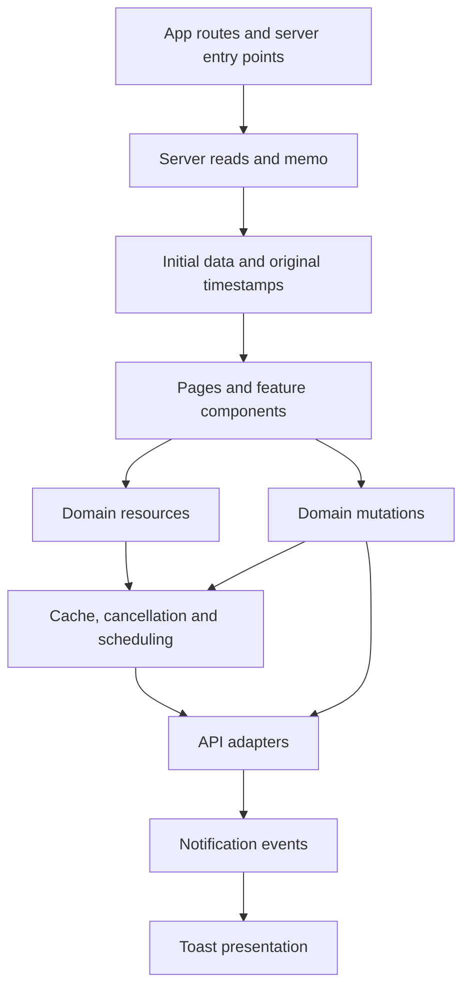

# Architecture

Data flow, module ownership and change entry points. Global constraints are in [AGENTS.md](../AGENTS.md); topic contracts are listed in the [documentation index](README.md).

## Data flow

- `lib/resource.ts` owns server answers; `lib/screenState.ts` owns page, tab and contact selection.
- Reads reach adapters through resources. Mutations update or expire cached data after server acknowledgement.
- SSR seeds keep their original fetch timestamp through hydration.
- Private data is scoped to the session token. Logout clears data and cancels requests; responses using a user API key must not enter public SSR caches.

## Change entry points

| Change | Entry | Contract |
| --- | --- | --- |
| Routes, metadata, initial data, loading | `app/` | [Transitions](transitions.md), [Data requests](data-requests.md) |
| Reads, keys, TTL, queues | `lib/api/*`, `lib/resources.ts`, domain `queries.ts` | [Backend API](backend-api.md), [Data requests](data-requests.md) |
| Mutations and cache updates | Domain actions and API adapters | Never automatically repeat an unknown-outcome write |
| Shared controls and tokens | `components/`, `app/globals.css` | [Primitives](design/primitives.md) |
| Notifications | UI: `components/Toast.tsx`; libraries: `lib/toast.ts` | [Module boundaries](module-boundaries.md) |
| Sessions and preferences | `lib/hooks.ts`, `lib/appearance.ts`, `lib/settingsSync.ts` | [Settings synchronization](data-requests.md#settings-synchronization) |
| Image-detail motion | `lib/hero/` | [Hero engine](hero.md) |
| General motion | `lib/motion/`, exported through `lib/motion.ts` | [Motion modules](module-boundaries.md#motion-modules), [Motion system](motion-system.md) |

## Dependency constraints

`bun run architecture:check` checks dependency directions with the TypeScript AST. Complete rules and exceptions are in [Module boundaries](module-boundaries.md).

- No static runtime cycles or client paths to server modules.
- Libraries do not import UI or routes, except the dynamic `hero/media.ts` warmup of `PicDetail`.
- The shell excludes motion implementations, Hero, Markdown, auth forms, palette generation and admin APIs from its static graph.
- Motion implementations import direct collaborators, not their facade. Keep geometry reads separate from playback.

## Verification

Choose checks for the affected area; run `bun run check` before every commit.

| Area | Command |
| --- | --- |
| Dependency directions | `bun run architecture:check` |
| Production build and lazy loading | `bun run build`, `bun run perf:weight` |
| Drawer gestures | `bun run test:drawer` |
| Tabs, scroll and Back | `bun run net:tabs`, `bun run net:tabnav` |
| Controls and screen interaction | `bun run test:ui`, `bun run test:browser` |
| Image detail, Hero and overlays | `bun run test:hero`, `bun run test:overlays` |
| Reads and prefetch | `bun run net:audit` |

Windows browser tests require Edge and Python Playwright. CI uses [.github/workflows/browser.yml](../.github/workflows/browser.yml). A dependency graph check does not measure production script weight.

## Deployment

The current deployment model is one Node process. `lib/serverMemo.ts`, `lib/rateLimit.server.ts` and cache invalidation do not coordinate across instances.

Before deploying replicas, add shared caching, invalidation and rate limiting, then verify that a write accepted by one instance is visible to the others. Packaging commands and platform restrictions are in the [project README](../README.md#部署).
