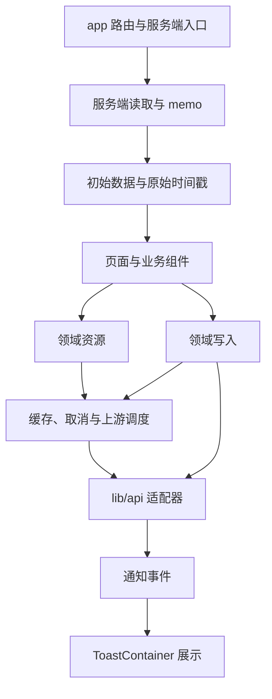

# 架构导读

本页说明代码的当前职责与修改入口。全局规则见根目录 `AGENTS.md`，各领域的界面契约和历史原因见 `docs/` 下对应文件（索引在 `AGENTS.md`）。

## 数据如何到达界面



服务器返回的数据由 `lib/resource.ts` 管理；页码、选中的标签和联系人等页面状态由 `lib/screenState.ts` 管理。读操作通过资源进入 API 适配器，写操作在服务器确认后更新或过期缓存。SSR 初始数据保留原始时间戳，不能在 hydration 时被重新标为刚获取。

## 修改入口

| 需求 | 入口与边界 |
| --- | --- |
| 新增路由 | `app/` 负责路由组合、元数据、初始数据与形状一致的加载态 |
| 新增业务读取 | 所属 `lib/api/*` 负责响应规范化与错误；`lib/resources.ts` 或业务 `queries.ts` 声明缓存键、TTL 和上游队列 |
| 修改写入行为 | 所属领域 actions 与 API 适配器；不要自动重试结果未知的写操作 |
| 调整共同控件 | `components/` 中的原语与 `app/globals.css`，避免在页面复制样式或交互逻辑 |
| 展示临时通知 | 界面从 `components/Toast` 使用 `showToast`；底层从 `lib/toast` 发布同一事件 |
| 修改账号与偏好 | `lib/hooks.ts` 的会话接口、`lib/appearance.ts` 和 `lib/settingsSync.ts` |
| 修改图片详情动效 | `lib/hero/`；公共外壳只依赖 `runtime.ts`，引擎由图片功能加载 |
| 修改一般动效 | `lib/motion/` 中对应职责模块，见下表 |

## 动效模块的职责

`lib/motion.ts` 是公共导出入口，`lib/motionLazy.tsx` 保留延迟加载和加载前的即时反馈。模块拆分不改变曲线、时长、动画中断或加载时机。

| 模块 | 拥有的职责 |
| --- | --- |
| `engine.ts` | GSAP 插件的一次注册、曲线、弹簧与全局速度 |
| `theme.ts` | 主题切换的 View Transition、指针起点和中断清理 |
| `drawer.ts` | 抽屉拖动、释放、外部关闭与生命周期清理 |
| `grid.ts` | 图库首次入场的级联，以及用户按下时结束入场 |
| `tabGeometry.ts` | 标签页可见内容的几何读取与跟随动画规划 |
| `sharedAxis.ts` | Web Animations 播放、反转与恢复原有样式 |
| `tabs.ts` | 标签页状态、滚动位置、面板高度和 React 提交时序 |

这些实现只引用自己的直接协作者，不反向引用 `lib/motion.ts`。主题切换通过 `tabs.ts` 的 `finishTabTransition` 结束正在进行的标签页动画；几何测量与播放分开，以保留先读后写的顺序。`useGSAP` 的编译器例外和清理契约保留在抽屉、图库模块内。

## 依赖约束

`npm run architecture:check` 使用 TypeScript AST 检查别名、相对路径、重导出和字面量动态导入：

- 静态运行时图不允许循环依赖；客户端不能到达服务端模块。
- `lib/` 不依赖路由实现或界面组件。唯一明确例外是 `hero/media.ts` 在图片意图发生时动态预热 `PicDetail` 的代码；它不渲染组件，也不需要组件先挂载。
- 外壳不能静态引入动效实现、Hero 引擎、Markdown、认证表单、调色引擎或管理 API。
- 动效实现之间的依赖白名单记录在架构测试中，增加协作者时需要明确它的职责。

`lib/toast.ts` 只传递通知，支持界面订阅前暂存。`ToastContainer` 决定如何显示、合并重复提示、播报和关闭。鉴权失败和设置同步不加载界面模块。

## 验证

```bash
npm run check
npm run build
npm run test:drawer
npm run net:tabs
npm run net:tabnav
npm run test:ui
```

前两项验证代码与生产构建。后三类浏览器回归分别覆盖抽屉中断、标签页的滚动与返回导航、真实界面行为，使用项目现有的本地夹具。修改图片详情、Hero 历史或弹层时，还应运行 `test:hero`、`test:overlays`。Windows 浏览器测试依赖已安装的 Edge 和 Python Playwright；CI 配置在 `.github/workflows/browser.yml`。

静态依赖图用于检查边界，生产脚本体积由 `npm run perf:weight` 测量，两者不能相互替代。

## 部署约束

当前运行模型是单 Node 进程。`lib/serverMemo.ts`、`lib/rateLimit.server.ts` 和缓存失效没有跨实例协调。多副本部署前，需要让缓存失效和限流使用共享后端，并验证一台实例接受写入后，其他实例能及时看到结果。

个人数据受会话令牌约束，退出登录时清空并取消旧账号的请求。不要为复用公共 SSR 缓存而将带用户 API key 的结果放进共享缓存。
